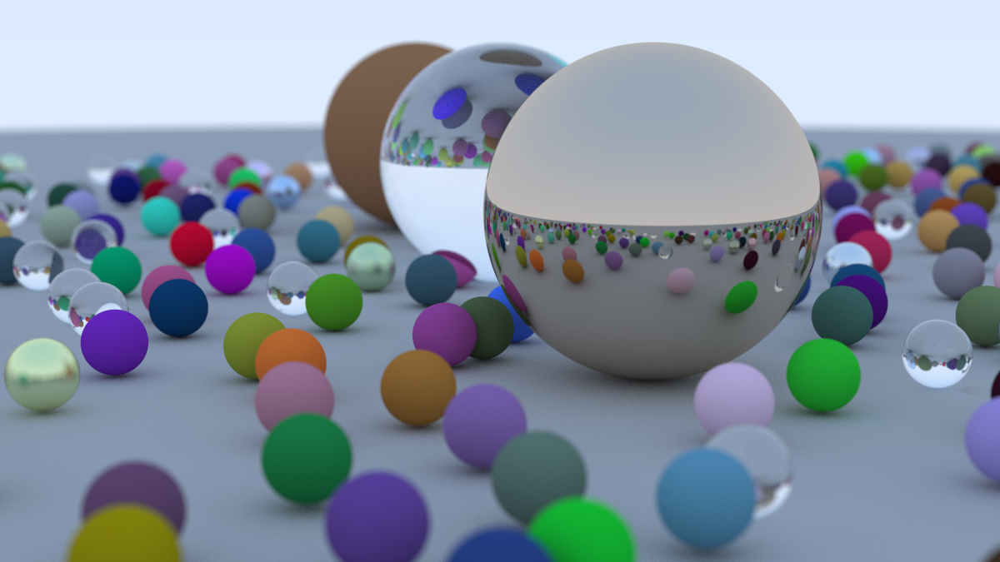
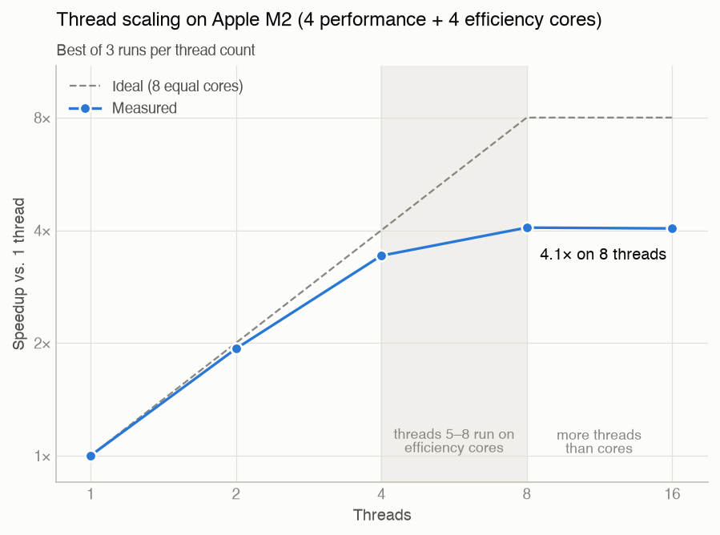

# Hero Tracer

A multithreaded CPU path tracer in C++17. The renderer is an extension of and follows [*Ray Tracing in One Weekend*](https://raytracing.github.io/books/RayTracingInOneWeekend.html). Optimizing it, parallelizing it, benchmarking it, and explaining the results are my own work on top of the book.

**Results:** multithreading cuts the book's final scene from 189 s to 46.5 s on an Apple M2 (4.07x speedup). If we are counting the compiler optimization as well, it renders 88.5x faster than the original unoptimized build that took 68 minutes.



*Hero Settings: 1200x675 pixels, 500 samples per pixel
 Rendered in 240 seconds on 8 threads. The original unoptimized compiler, single-threaded build would need an estimated 5.7 hours (this is because render time grows linear with samples per pixel).*

## Results

| Build | Threads | Render time | Speedup vs. `-O0` |
|---|--:|--:|--:|
| Unoptimized (`-O0`) | 1 | 4,117s (68.6 min) | 1x |
| Optimized (`-O3`) | 1 | 189.1s | 21.8x |
| Optimized (`-O3`) | 8 | 46.5s | 88.5x |

**Workload:** The book's final scene (about 485 spheres), 1200x675 pixels, 100 samples per pixel, up to 50 bounces per ray. To get the optimized times I chose the best of 3 runs. The `-O0` time is a single run, since it takes over an hour. The `-O0` run happened before a seeding change reshuffled the random sphere layout. The optimized single-thread time differs by only 0.2% between the two layouts (188.7 s vs. 189.1 s), so the comparison holds.

## Thread Scaling



| Threads | Time (s) | Speedup |
|--:|--:|--:|
| 1 | 189.12 | 1.00x |
| 2 | 97.97 | 1.93x |
| 4 | 55.27 | 3.42x |
| 8 | 46.52 | 4.07x |
| 16 | 46.75 | 4.05x |

- Up to 4 threads, each thread gets its own performance core. 2 threads reach 97% of perfect scaling. While 4 threads reached 86%.
- Runs with 5–8 threads include efficiency cores, which add only 0.64x together. In this measurement a thread is worth roughly 1/5 of a performance core.
- 16 threads perform the same as 8. Since there are only 8 cores, the extra threads just take turns.
- Writing the image isn't the bottleneck. It's the only step that can't run in parallel, and it takes 0.1% of the single-thread runtime. By Amdahl's law, that alone would still allow 7.95x speedup on 8 identical cores.

### Why Not 8x For 8 Threads?

1. The M2 doesn't have 8 equal cores. The dashed "ideal" line assumes it does. Four perfect performance cores plus the measured 0.64x from the efficiency cores puts the realistic ceiling under 5x.
2. Performance cores already lose 14% at 4 threads. But there are two potential reasons why. I tested neither yet:
   - **Clock speed and heat.** One busy core runs at a higher clock speed than four busy cores, and this MacBook Air has no fan.
   - **Shared reference counts.** Each time a ray hits a sphere, the code copies a `shared_ptr<material>`, which atomically updates a counter shared by every thread. Popular materials, like the ground's, get updated by all cores at once, so the memory holding that counter keeps moving between cores.

## How the Hero renderer works

The render loop, simplified from `camera.h`:

```cpp
std::vector<color> framebuffer(image_width * image_height);
std::atomic<int> next_row{0};

auto worker = [&] {
    while (true) {
        int j = next_row.fetch_add(1);    // claim the next unrendered row
        if (j >= image_height) return;    // no rows left: this thread is done
        for (int i = 0; i < image_width; i++)
            framebuffer[j * image_width + i] = render_pixel(i, j);
    }
};

std::vector<std::thread> pool;
for (int t = 0; t < nthreads; t++) pool.emplace_back(worker);
for (auto& th : pool) th.join();          // wait until every row is done
// one thread then writes the framebuffer to the output file
```

- **Framebuffer.** Pixels go into an array in memory (one slot per pixel, about 19 MB) instead of streaming straight to the output file. Rows can then finish in any order, and one thread writes the file at the end.
- **Dynamic row scheduling.** `fetch_add` adds 1 to the counter and returns its previous value in one indivisible step, so no two threads can get the same row. Rows cost different amounts: sky rows finish quickly, while rows through glass take much longer. Handing out rows on demand keeps every core busy until the image is done, because faster cores simply come back for more. Giving each thread a fixed block of rows instead would leave fast threads idle while the slowest one finishes, which is worse on the M2, whose efficiency cores are much slower.
- **No locks.** Everything the threads share is either read-only during the render (the scene and camera settings), owned by one thread (a row's pixels are written only by the thread that claimed it), or atomic (the row counter). Nothing needs a mutex.

One random number generator per thread. The book uses a single shared generator, and calling it from several threads at once is a data race. I made this thread safe by each thread now getting its own seeded from an atomic counter (`utility.h`):

```cpp
inline double random_double() {
    static std::atomic<int> seed_counter{0};
    thread_local std::mt19937 generator(seed_counter.fetch_add(1));
    thread_local std::uniform_real_distribution<double> distribution(0.0, 1.0);
    return distribution(generator);
}
```

The main thread calls it first, while building the scene, so it always gets seed 0. Every run now renders the identical sphere layout and this is important because we need to keep benchmarks comparable across all runs. Worker threads get seeds 1, 2, 3, and so on, so each has its own random stream and rows next to each other don't repeat.

## Verification

- **The framebuffer refactor changed nothing.** I rendered the scene before and after the change with the same settings, and `cmp` found the two output files byte-identical. This works because the same seed produces the same random numbers in the same order, and identical floating-point operations give identical results.
- **Multithreaded images aren't byte-identical to single-threaded ones, by design.** Which thread renders which row depends on scheduling, so a row's noise comes from a different random stream on each run. Both are equally valid renders of the same scene.

## How it was measured

- **Optimized build:** CMake Release (`-O3 -DNDEBUG`), confirmed in the flags actually passed to the compiler, not just the CMake setting.
- **Timer:** `std::chrono::steady_clock`, a monotonic clock that is never adjusted mid-run the way the system clock can be. Rendering and file writing are timed separately.
- **Three runs per thread count, fastest run kept.** The fastest run is the cleanest measurement. Rounds go 1, 2, 4, 8, 16 threads and then repeat, so the CPU warming up affects every thread count equally, with 60s of rest between each run.
- **Controlled machine:** I made sure my M2 was plugged in, other apps closed, blocked sleep with `caffeinate`. One run early on battery power came out 71% slower; it stays in the log, marked as excluded.
- **Traceable results:** I traced each measurement by saving the commit that produced it. The raw data is in [`bench/scaling.csv`](bench/scaling.csv), and the full log is in [`benchmarks.md`](benchmarks.md).

**Machine:** MacBook Air, Apple M2 (4 performance + 4 efficiency cores), 8 GB RAM (sad ik).

## How to Build and Run

Requires CMake and a C++17 compiler.

```bash
cmake -B build -DCMAKE_BUILD_TYPE=Release
cmake --build build
build/main 8 > image.ppm    # 8 = thread count, leave it out to use every core
```

Progress and timing print to the terminal, and the image goes to `image.ppm`. To convert it, use **ImageMagick**: `magick image.ppm image.png`. Image size and samples per pixel are set in `main.cpp`.

## Reproduce the benchmarks

Requires Python 3 with matplotlib.

```bash
caffeinate -i python3 bench/sweep.py   # 1, 2, 4, 8, 16 threads x 3 rounds, about 36 min
python3 bench/analyze.py               # prints the table, writes docs/scaling.png
```

`sweep.py` Must commit each change before running, so every result goes to a commit.

## Project layout

| Path | Contents |
|---|---|
| `main.cpp` | Scene setup and render settings |
| `camera.h` | Camera, multithreaded render loop, timing |
| `material.h` | Diffuse, metal, and glass materials |
| `sphere.h`, `hittable.h`, `hittable_list.h` | Ray–sphere intersection and the scene list |
| `vec3.h`, `ray.h`, `interval.h`, `color.h`, `utility.h` | Vector math, color output, per-thread random numbers |
| `bench/` | Benchmark scripts and raw results |
| `benchmarks.md` | Full measurement log |

## Next steps

1. **Find the missing 14%.** Replace the `shared_ptr` in the hit record with a plain `material*` (safe here, since the scene outlives the render) and rerun the sweep. If 4-thread efficiency climbs from 86% toward 95%, the shared counters were the cause. If not, record core clock speeds during a run with `sudo powermetrics --samplers cpu_power`.
2. **Add a bounding volume hierarchy (BVH).** Every ray currently tests all ~485 spheres. A BVH groups nearby spheres into nested boxes, so a ray can skip whole groups at once. A 1-thread render is fully deterministic (one worker, one seed, rows in order), so the BVH version can be checked byte-for-byte against the current one.
3. **Port the renderer to the GPU** with Metal compute shaders.

## Credits

[*Ray Tracing in One Weekend*](https://raytracing.github.io/books/RayTracingInOneWeekend.html) by Peter Shirley, Trevor David Black, and Steve Hollasch.
